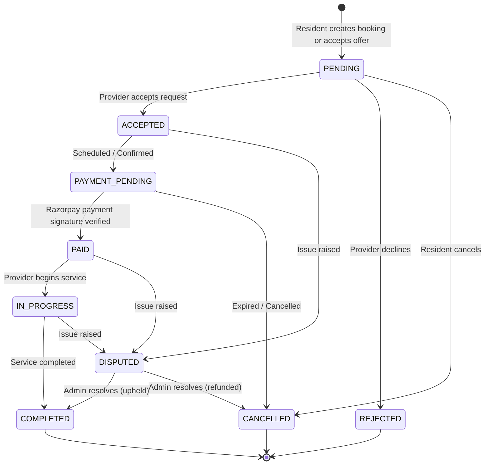

# 🏘️ Neighborly

> **Hyperlocal Service Marketplace connecting urban residents with trusted, verified local service professionals.**

[](LICENSE)
[](https://nodejs.org/)
[](https://react.dev/)
[](https://expressjs.com/)
[](https://www.mongodb.com/)
[](https://socket.io/)
[](https://tailwindcss.com/)
[](https://vitejs.dev/)
[-02042B.svg)](https://razorpay.com/)

---

## 📌 Executive Summary

**Neighborly** is an end-to-end, production-grade Hyperlocal Service Marketplace built with the MERN stack (MongoDB, Express, React, Node.js). It bridges the discovery and trust gap between urban residents and nearby independent service providers across essential trades: **plumbing, electrical repairs, appliance servicing, home cleaning, tutoring, carpentry, and painting**.

The platform is designed around three distinct user personas (**Resident**, **Provider**, and **Administrator**), backed by a rigid booking state machine, real-time messaging via Socket.IO, server-side verified Razorpay payments (test mode), a hybrid AI provider matching algorithm, and an automated fallback parser for natural language service requests.

---

## 📑 Table of Contents

- [Executive Summary](#-executive-summary)
- [Key Features](#-key-features)
- [System Architecture](#-system-architecture)
- [Technology Stack](#-technology-stack)
- [Repository Structure](#-repository-structure)
- [Quick Start Guide](#-quick-start-guide)
  - [Prerequisites](#prerequisites)
  - [1. Clone Repository](#1-clone-the-repository)
  - [2. Install Dependencies](#2-install-all-dependencies)
  - [3. Configure Environment Variables](#3-configure-environment-variables-secure)
  - [4. Start the Application](#4-run-development-servers)
  - [5. Seed Demo Data](#5-optional-seed-demo-database)
- [Pre-Configured Demo Accounts](#-pre-configured-demo-accounts)
- [Environment Variables Guide](#-environment-variables-guide)
- [Core Workflows](#-core-workflows)
  - [Resident Experience](#a-resident-journey)
  - [Provider Experience](#b-provider-journey)
  - [Admin Control Center](#c-admin-control-center)
- [Booking State Machine](#-booking-state-machine)
- [AI Engine & Resilient Fallback](#-ai-engine--resilient-fallback)
- [API Reference](#-api-reference)
- [Testing & Quality Assurance](#-testing--quality-assurance)
- [Security & Production Hardening](#-security--production-hardening)
- [License](#-license)

---

## 🌟 Key Features

### 🧠 1. AI-Powered Service Request Assistant
- **Natural Language Parsing**: Residents can describe issues in plain English (e.g., *"My kitchen sink pipe is leaking under the basin tomorrow morning, budget around 600"*).
- **Automated Extraction**: Extracts service category, schedule preference, budget limit, and recommended skills using Google Gemini AI models.
- **Resilient Heuristic Fallback**: If the AI model or API key is unavailable/offline, the system automatically engages an internal rule-based regex NLP parser—guaranteeing 100% operational uptime.
- **Human-in-the-Loop Confirmation**: Form fields are pre-filled for resident review, adjustment, and manual submission before persistence.

### 🎯 2. Deterministic & Hybrid Provider Matching
- **Hard Constraint Filtering**: Excludes unverified, inactive, or out-of-radius providers deterministically.
- **Multi-Factor Scoring**: Ranks remaining candidates based on verified ratings, completed booking volume, category specialization, hourly rates, and geographic proximity.
- **Transparent Match Explanations**: Provides human-readable reasoning explaining why each professional was suggested.

### 🔄 3. Robust Booking Lifecycle State Machine
- Strict server-guarded transition paths: `PENDING` ➔ `ACCEPTED` ➔ `PAYMENT_PENDING` ➔ `PAID` ➔ `IN_PROGRESS` ➔ `COMPLETED`.
- Guard rails preventing invalid skips or client-side tampering.
- Complete handling of exceptional paths: `REJECTED`, `CANCELLED`, and `DISPUTED`.

### 💬 4. Real-Time Chat & Live Notifications
- Real-time bi-directional messaging powered by **Socket.IO**.
- Scoped room authorization: only authenticated booking participants can join and send messages.
- Live in-app alerts triggered on booking creation, status updates, new quotes, and payments.

### 💳 5. Razorpay Payment Gateway (Test Mode)
- Server-side order creation (`orders.create` in smallest currency unit: paise).
- Client-side checkout modal.
- Cryptographic verification of payment signatures using `HMAC-SHA256`.
- Idempotent webhook handling with replay protection and clear **TEST MODE** badges.

### 🛡️ 6. Trust, Verification & Dispute Resolution
- **Provider Verification Pipeline**: Document and trade license verification by administrators.
- **Authenticated Reviews**: Reviews and ratings are restricted strictly to completed, verified bookings to eliminate review fraud.
- **Dispute Mediation Center**: Both parties can raise disputes, which are mediated and resolved by administrators with audit logging.

### 📊 7. Admin Governance & Platform Analytics
- Live telemetry dashboard powered by **Recharts**: booking volume trends, category breakdown, user distribution, and platform metrics.
- Provider verification queue with approval/rejection notes.
- User management with suspend/reactivate capabilities.

### ⚡ 8. Zero-Friction Database Setup
- Seamless support for **MongoDB Atlas** (Cloud) or **Local MongoDB**.
- **Automated In-Memory MongoDB Fallback**: If no database URI is provided, an in-memory database instance initializes automatically, allowing the app to run instantly out-of-the-box with zero initial setup.

---

## 🏗️ System Architecture

Neighborly implements a clean, layered architectural pattern:

```
[ Client: React 18 + Vite + Tailwind CSS + Zustand + React Query ]
                               │
                       REST / WebSocket
                               │
[ Server: Express API + Socket.IO + Rate Limiter + Helmet Security ]
                               │
        ┌──────────────────────┼──────────────────────┐
        ▼                      ▼                      ▼
[ Service Layer ]       [ AI Engine / NLP ]   [ Razorpay Gateway ]
        │               (Gemini + Fallback)     (HMAC-SHA256)
        ▼
[ Mongoose ODM Layer ]
        │
[ MongoDB (Atlas / Local / In-Memory Server) ]
```

### Architecture Diagram
For the full architectural and sequence diagrams, see:
- System Architecture: `documentation/report_assets/fig3_1_system_architecture.png`
- Use Case Diagram: `documentation/report_assets/fig3_2_use_case_diagram.png`
- Sequence Diagram: `documentation/report_assets/fig3_4_sequence_diagram.png`

---

## 💻 Technology Stack

| Layer | Technologies |
| :--- | :--- |
| **Frontend** | React 18, Vite 6, Tailwind CSS 3.4, React Router v7, Zustand, TanStack React Query v5, Recharts, Lucide React, React Hook Form, Zod |
| **Backend** | Node.js (ES Modules), Express 4.21, Socket.IO 4.8, Pino Logger, Helmet, Express Rate Limit, CORS, Zod |
| **Authentication & RBAC** | JSON Web Tokens (JWT), Bcrypt.js, Custom Role-Based Middleware (Resident, Provider, Admin) |
| **Database & ORM** | MongoDB, Mongoose 8.9, MongoDB Memory Server (Zero-config development fallback) |
| **Payments** | Razorpay Node SDK (Test Mode) with cryptographic HMAC-SHA256 verification |
| **AI / NLP** | Google Gemini 1.5 Flash (via `@google/genai` or REST) + Deterministic Heuristic Regex Parser Fallback |
| **Testing** | Node.js native test runner (`node --test`), In-Memory MongoDB Isolation |

---

## 📁 Repository Structure

```
Neighborly/
├── client/                     # Frontend Application (React + Vite)
│   ├── src/
│   │   ├── api/                # Axios API client & endpoints
│   │   ├── components/         # Reusable UI & layout components
│   │   │   ├── common/         # Navbar, Footer, Buttons, Modals, ProtectedRoute
│   │   │   ├── booking/        # Booking cards, status badges, timers
│   │   │   ├── chat/           # Chat window, message items, input box
│   │   │   └── provider/       # Provider cards, rating stars, filters
│   │   ├── layouts/            # Public, Resident, Provider, and Admin layouts
│   │   ├── pages/              # Routed pages across all 3 personas
│   │   ├── store/              # Zustand state stores (authStore, etc.)
│   │   ├── App.jsx             # React Router route registry
│   │   └── main.jsx            # Application entry point
│   ├── .env.example            # Client environment template
│   ├── package.json
│   ├── tailwind.config.js
│   └── vite.config.js
│
├── server/                     # Backend API & Socket Server
│   ├── src/
│   │   ├── config/             # DB connection, env validation, logger
│   │   ├── controllers/        # Request handlers (auth, bookings, payments, etc.)
│   │   ├── middleware/         # Auth, RBAC, error handling, rate limiting
│   │   ├── models/             # Mongoose schemas (User, Booking, Service, etc.)
│   │   ├── routes/             # Express API route modules
│   │   ├── scripts/            # Database seed and test scripts
│   │   ├── services/           # Business logic, AI engine, payment verification
│   │   ├── sockets/            # Socket.IO handlers and event channels
│   │   ├── app.js              # Express app configuration & middleware
│   │   └── server.js           # Server bootstrap and graceful shutdown
│   ├── tests/                  # Automated integration and unit tests
│   ├── .env.example            # Server environment template
│   └── package.json
│
├── documentation/              # Design specifications, diagrams & deployment guides
│   ├── report_assets/          # Architectural, DFD, and UI screenshots
│   ├── DEPLOYMENT_GUIDE.md     # Production deployment instructions
│   └── PROJECT_PLAN.md         # Milestone and execution status
│
├── package.json                # Root workspace configuration
├── .gitignore                  # Git hygiene (ignoring node_modules, .env, secrets)
└── README.md                   # Project documentation
```

---

## 🚀 Quick Start Guide

### Prerequisites
- **Node.js** >= `18.0.0`
- **npm** >= `9.0.0`
- *(Optional)* Local MongoDB or MongoDB Atlas connection string. If omitted, the server runs seamlessly using an automatic in-memory MongoDB database.

---

### 1. Clone the Repository

```bash
git clone https://github.com/pragathi-priya01/Neighborly.git
cd Neighborly
```

---

### 2. Install All Dependencies

Use the root workspace script to install root, client, and server dependencies in one command:

```bash
npm run install:all
```

---

### 3. Configure Environment Variables (Secure)

Create local `.env` files for both the server and client by copying their `.env.example` templates.

> 🔒 **Security Notice**: Do **NOT** commit `.env` files to source control. They are ignored by default via `.gitignore`. Replace placeholders with your own keys or leave optional fields blank for automatic fallbacks.

#### A. Backend Environment Setup
```bash
cp server/.env.example server/.env
```

Open `server/.env` and review the settings:
```ini
NODE_ENV=development
PORT=5000

# Leave blank for automated zero-config in-memory MongoDB, OR provide your Atlas string:
# MONGODB_URI=mongodb+srv://<username>:<password>@cluster0.example.mongodb.net/neighborly?retryWrites=true&w=majority
MONGODB_URI=

CLIENT_URL=http://localhost:5173

# Secret for signing JWT tokens (generate a strong random string)
JWT_SECRET=replace_with_a_secure_random_secret_at_least_32_characters
JWT_EXPIRES_IN=7d

# Razorpay Test Mode credentials (obtain from your Razorpay Dashboard in Test Mode)
RAZORPAY_KEY_ID=rzp_test_placeholder_key_id
RAZORPAY_KEY_SECRET=placeholder_secret_key
RAZORPAY_WEBHOOK_SECRET=placeholder_webhook_secret
RAZORPAY_MODE=test

# Optional: Google Gemini API key (Heuristic regex fallback runs if blank)
AI_API_KEY=
AI_MODEL=gemini-1.5-flash
```

#### B. Frontend Environment Setup
```bash
cp client/.env.example client/.env
```

Open `client/.env` and review:
```ini
VITE_API_URL=http://localhost:5000/api
VITE_SOCKET_URL=http://localhost:5000
VITE_RAZORPAY_KEY_ID=rzp_test_placeholder_key_id
```

---

### 4. Run Development Servers

Run the backend and frontend concurrently in separate terminal windows:

#### Terminal 1: Backend Server (Port 5000)
```bash
npm run dev:server
```
The server will start on `http://localhost:5000`. You can verify API health at:
```
GET http://localhost:5000/api/health
```

#### Terminal 2: Frontend App (Port 5173)
```bash
npm run dev:client
```
The client will start on `http://localhost:5173`. Open your browser to explore the app!

---

### 5. (Optional) Seed Demo Database

To pre-populate service categories, verified service providers, and sample test users:

```bash
npm run seed
```

---

## 👥 Pre-Configured Demo Accounts

For immediate evaluation in development mode, the database includes pre-seeded demo accounts representing each persona:

| Persona | Name | Email | Password | Location / Focus |
| :--- | :--- | :--- | :--- | :--- |
| **Administrator** | Platform Admin | `admin@neighbourly.local` | `Admin@1234` | Central Platform Oversight |
| **Resident** | Arun Sharma | `arun.resident@neighbourly.local` | `Resident@123` | Indiranagar |
| **Resident** | Priya Venkatesh | `priya.resident@neighbourly.local` | `Resident@123` | Koramangala |
| **Provider** | Rajesh Kumar | `rajesh.plumbing@neighbourly.local` | `Provider@123` | Plumbing Specialist (Indiranagar) |
| **Provider** | Suresh Patel | `suresh.electric@neighbourly.local` | `Provider@123` | Certified Electrician (Koramangala) |

> ⚠️ *Note: These credentials are intended for local development and demonstration only. Change all default passwords before deploying to any production environment.*

---

## 🔐 Environment Variables Guide

### Server (`server/.env`)

| Variable | Description | Example / Default | Required |
| :--- | :--- | :--- | :---: |
| `NODE_ENV` | Application runtime environment | `development` / `production` | Yes |
| `PORT` | Port for the Express server to listen on | `5000` | Yes |
| `MONGODB_URI` | MongoDB connection URI. If left blank, in-memory DB is used | `mongodb://localhost:27017/neighborly` | No (dev fallback) |
| `CLIENT_URL` | Frontend origin for CORS policy | `http://localhost:5173` | Yes |
| `JWT_SECRET` | Secret key for signing and validating JWTs | `<random-hex-or-string>` | Yes |
| `JWT_EXPIRES_IN`| Token validity window | `7d` | Yes |
| `RAZORPAY_KEY_ID` | Razorpay public key identifier (Test mode) | `rzp_test_xxxxxx` | For Payments |
| `RAZORPAY_KEY_SECRET` | Razorpay secret key | `<razorpay_secret>` | For Payments |
| `RAZORPAY_WEBHOOK_SECRET` | Secret used to verify webhook signatures | `<webhook_secret>` | Optional |
| `RAZORPAY_MODE` | Payment gateway mode | `test` | Yes |
| `AI_API_KEY` | Google Gemini API key for natural language requests | `<gemini-api-key>` | Optional (has fallback) |
| `AI_MODEL` | Gemini model variant | `gemini-1.5-flash` | No |

### Client (`client/.env`)

| Variable | Description | Example / Default | Required |
| :--- | :--- | :--- | :---: |
| `VITE_API_URL` | Base URL for REST API endpoints | `http://localhost:5000/api` | Yes |
| `VITE_SOCKET_URL` | Server URL for real-time Socket.IO connection | `http://localhost:5000` | Yes |
| `VITE_RAZORPAY_KEY_ID` | Razorpay test key ID for opening checkout modal | `rzp_test_xxxxxx` | For Payments |

---

## 🔄 Core Workflows

### A. Resident Journey
1. **Discover Services**: Browse verified providers with category filtering, ratings, and radius search.
2. **AI Service Request**: Describe an issue using the natural language prompt or traditional form.
3. **Compare Quotes**: Review incoming provider offers and inspect provider badges.
4. **Accept & Connect**: Accept an offer to initialize a booking and enter a live Socket.IO chat room.
5. **Payment**: Complete booking payment using Razorpay Test Mode with server signature verification.
6. **Review & Disputes**: Rate verified providers upon completion or open an administrative dispute if needed.

### B. Provider Journey
1. **Profile Onboarding**: Set service catalog, hourly pricing, operational radius, and upload certifications.
2. **Explore Request Feed**: View broadcasted resident requests matching trade and locality.
3. **Submit Offers**: Submit detailed quotes with estimated completion timelines.
4. **Manage Bookings**: Accept bookings and advance states (`IN_PROGRESS` ➔ `COMPLETED`).
5. **Reputation Building**: Accumulate verified resident reviews to boost matching score.

### C. Admin Control Center
1. **Platform Analytics**: Monitor real-time charts on user growth, category distribution, and booking metrics.
2. **Provider Verification**: Inspect submitted trade licenses and approve/reject provider accounts.
3. **User Governance**: Search, inspect, and toggle user account statuses.
4. **Dispute Resolution**: Review contested booking evidence and issue binding resolutions.

---

## ⚡ Booking State Machine

The booking lifecycle is enforced through a strict, tamper-proof state machine on the server:



---

## 🧠 AI Engine & Resilient Fallback

The AI Service Request Assistant extracts structured requirements from arbitrary natural language:

```
"My geyser is not heating water since yesterday, need an electrician tomorrow 6pm, budget 800"
                                    │
                                    ▼
       ┌────────────────────────────────────────────────────────┐
       │   AI Engine: Google Gemini 1.5 Flash (via API)         │
       │   (Validates against Zod schema)                       │
       └────────────────────────────┬───────────────────────────┘
                                    │ Fail / Offline / No Key
                                    ▼
       ┌────────────────────────────────────────────────────────┐
       │   Resilient Fallback: Internal Rule-Based NLP Parser   │
       │   - Regex Category Intent ("geyser" -> Appliance)      │
       │   - Temporal Parsing ("tomorrow 6pm" -> ISO String)    │
       │   - Currency Extractor ("800" -> Budget: 800 INR)      │
       └────────────────────────────┬───────────────────────────┘
                                    │
                                    ▼
               Pre-filled, editable UI Confirmation Form
```

---

## 📡 API Reference

### Health & Core
- `GET /api/health` - Live status check (DB connectivity, uptime, storage type)

### Authentication (`/api/auth`)
- `POST /register` - Create Resident or Provider account
- `POST /login` - Authenticate user & issue JWT
- `GET /me` - Fetch authenticated user profile

### Services & Providers (`/api/services`, `/api/providers`)
- `GET /api/services` - List active service categories
- `GET /api/providers` - Search and filter verified providers
- `GET /api/providers/:id` - Fetch provider profile, skills, and reviews
- `PUT /api/providers/profile` - Update provider skills, pricing, and radius

### Requests & Offers (`/api/requests`, `/api/offers`)
- `POST /api/requests` - Create structured service request
- `GET /api/requests/resident` - List current resident's requests
- `GET /api/requests/nearby` - Provider feed of local matching requests
- `POST /api/offers` - Provider submits quote on a request
- `POST /api/offers/:id/accept` - Resident accepts quote & initiates booking

### Bookings (`/api/bookings`)
- `GET /api/bookings` - List authenticated user's bookings
- `GET /api/bookings/:id` - Detailed booking status & timeline
- `PATCH /api/bookings/:id/status` - Transition booking state with role guard

### Payments (`/api/payments`)
- `POST /api/payments/create-order` - Create server-side Razorpay order
- `POST /api/payments/verify` - Verify cryptographic HMAC payment signature
- `POST /api/payments/webhook` - Idempotent Razorpay webhook listener

### Real-time Communication (`/api/chat`)
- `GET /api/chat/conversations` - List user conversations
- `GET /api/chat/messages/:conversationId` - Retrieve conversation history

### Admin (`/api/admin`)
- `GET /api/admin/dashboard` - Platform telemetry and metrics
- `GET /api/admin/verifications` - Pending provider applications
- `PATCH /api/admin/verifications/:id` - Approve or reject provider credentials
- `GET /api/admin/disputes` - Contested bookings requiring mediation

---

## 🧪 Testing & Quality Assurance

The backend includes an automated test suite verifying:
- **Authentication & RBAC**: Prevents role escalation and unauthorized endpoints.
- **AI Request Assistant & Fallback**: Validates NLP parsing across all categories.
- **Booking State Machine**: Tests valid transitions and asserts illegal state changes throw errors.
- **Admin Telemetry & Verification**: Confirms admin authority and metric calculations.

To execute the test suite:
```bash
npm run test:server
```

---

## 🛡️ Security & Production Hardening

- **No Secrets Exposed**: All sensitive credentials reside strictly in local `.env` files that are ignored by git.
- **Tamper-Proof Payments**: Client payment tokens are cryptographically verified using server-side HMAC-SHA256 signatures before any booking status advances to `PAID`.
- **Role-Based Access Control (RBAC)**: All routes validate authenticated user identity and explicitly verify roles (`RESIDENT`, `PROVIDER`, `ADMIN`).
- **In-Depth Defense Middleware**:
  - `helmet`: Sets secure HTTP response headers.
  - `express-rate-limit`: Prevents brute force and denial of service attacks.
  - `cors`: Strict origin validation against allowed frontend domains.
  - `zod`: Input validation and sanitization on all inbound payloads.
  - `IDOR Protection`: Validates resource ownership on booking and chat queries.

---

## 📦 Production Build

To compile and bundle the client application for production:

```bash
npm run build:client
```

The optimized static assets will be output to `client/dist`.

---

## 📄 License

This project is licensed under the [MIT License](LICENSE).

---

<p align="center">
  Built with ❤️ for vibrant, trusted, and empowered neighborhoods.
</p>
